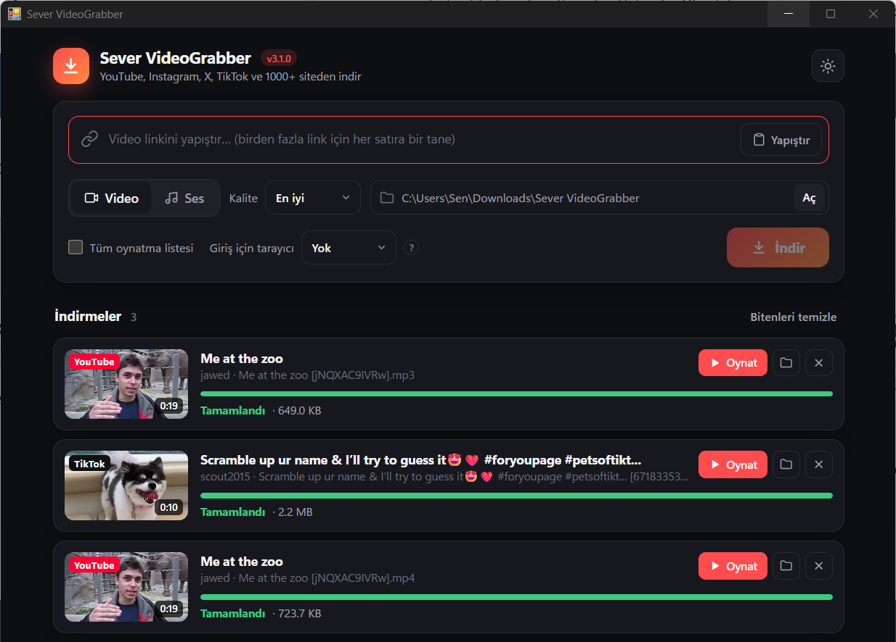

<div align="center">


# Sever VideoGrabber v3.1

**YouTube, Instagram, X/Twitter, TikTok ve 1000+ siteden tek tıkla video & ses indir.**

[](https://github.com/yusufkrk/sever-videograbber/actions/workflows/ci.yml)
[](https://github.com/yusufkrk/sever-videograbber/releases/latest)
[](https://www.python.org/)
[](LICENSE)
[](https://github.com/yusufkrk/sever-videograbber/releases)

[Türkçe](#-özellikler) · [English](#-english)

</div>

<p align="center"></p>

## 🚀 Hızlı başlangıç

1. [**Releases**](https://github.com/yusufkrk/sever-videograbber/releases/latest) sayfasından bilgisayarına uygun dosyayı indir:
   - **Windows:** `videograbber-windows-x64.exe`
   - **Mac (M1/M2/M3/M4):** `SeverVideoGrabber-macos-apple-silicon.zip`
   - **Mac (Intel):** `SeverVideoGrabber-macos-intel.zip`
2. Windows'ta exe'ye **çift tıkla**. Mac'te zip'i aç, **Sever VideoGrabber**'ı *Uygulamalar* klasörüne sürükle ve çift tıkla ([ilk açılış](#-macte-ilk-açılış)).
3. Linki yapıştır, **Video** ya da **Ses** seç, **İndir**'e bas. Bitince **Oynat** ya da **Klasörde göster**. 🎉

Kurulum yok, terminal yok. Dosyalar *İndirilenler/Sever VideoGrabber* klasörüne iner.

## ✨ Özellikler

- 🌍 **1000+ site** — YouTube, Instagram (Reels, gönderi, hikâye), X/Twitter, TikTok, Facebook, Reddit, Vimeo, Twitch, SoundCloud, Threads, Bluesky ve dahası ([yt-dlp](https://github.com/yt-dlp/yt-dlp) altyapısı)
- 🎯 **Kalite seçimi** — 4K'dan 144p'ye; varsayılan olarak her yerde oynayan **MP4 (H.264/AAC)** tercih edilir
- 🎵 **Sadece ses** — MP3, M4A, OPUS, FLAC, WAV; kapak resmi ve etiketler dosyaya gömülür
- 📋 **Oynatma listeleri** — tüm listeyi ya da seçili öğeleri (`--items 1-5,8`) kendi klasörüne, numaralı indir
- ⚡ **Paralel indirme** — `-j 4` ile aynı anda birden çok link
- 📄 **Toplu indirme** — linkleri bir `.txt` dosyasından oku
- 💬 **Altyazılar** — istediğin dillerde, videonun içine gömülü
- 🔐 **Giriş isteyen siteler** — tarayıcındaki oturumu kullan: `--browser chrome`
- 🧠 **Anlaşılır hata mesajları** — "bot doğrulaması", "gizli video", "giriş gerekli" gibi durumları açıklar ve çözüm önerir
- 🖥️ **Modern masaüstü penceresi** — link yapıştır, kapak resimli kartlarda ilerlemeyi izle, tek tıkla oynat; koyu & açık tema
- 💻 **Güçlü komut satırı** — betikler ve ileri düzey kullanıcılar için tüm özellikler `videograbber` komutunda
- 📦 **Kurulum gerektirmez** — ffmpeg ve JavaScript motoru (deno) pakete dahil
- 🌐 **Türkçe & English** arayüz · ⚙️ ayar dosyası · 🗂️ arşiv (indirilenleri atla) · 🤖 betikler için `--json` çıktı · 🐍 Python kütüphanesi olarak kullanılabilir

## 📥 Kurulum

### Seçenek 1 — Hazır program (en kolayı)

[**Releases**](https://github.com/yusufkrk/sever-videograbber/releases/latest) sayfasından işletim sistemine uygun dosyayı indir:

| Sistem | Dosya |
| --- | --- |
| Windows 10/11 | `videograbber-windows-x64.exe` |
| macOS 11+ (M1/M2/M3/M4) | `SeverVideoGrabber-macos-apple-silicon.zip` |
| macOS 11+ (Intel) | `SeverVideoGrabber-macos-intel.zip` |
| Linux | `videograbber-linux-x64` |

Hangi Mac'in olduğunu bilmiyorsan: sol üstteki **Apple menüsü → Bu Mac Hakkında** → "Çip: Apple M…" yazıyorsa *apple-silicon*, "İşlemci: Intel" yazıyorsa *intel*.

**Windows:** `.exe`'ye **çift tıkla** → pencere açılır, linki yapıştır, bitti. 🎉 Program imzasız olduğu için SmartScreen "Windows bilgisayarınızı korudu" diyebilir → **Ek bilgi → Yine de çalıştır**. Aynı exe komut satırından da çalışır (`videograbber-windows-x64.exe https://...`).

**Linux:** `chmod +x videograbber-linux-x64 && ./videograbber-linux-x64` — arayüz varsayılan tarayıcında açılır (pencere için `pip install pywebview[qt]`).

### 🍎 Mac'te ilk açılış

1. İndirdiğin `.zip`'e çift tıkla → **Sever VideoGrabber** uygulaması çıkar. Onu **Uygulamalar** (Applications) klasörüne sürükle.
2. Uygulamaya çift tıkla. Uygulama Apple'a ücretli olarak onaylatılmadığı için macOS bir uyarı gösterir → **Bitti**'ye bas.
3. **Sistem Ayarları → Gizlilik ve Güvenlik**'i aç, aşağı kaydır, "Sever VideoGrabber engellendi" yazısının yanındaki **Yine de Aç**'a bas ve onayla.
4. Bundan sonra normal bir uygulama gibi açılır. İlk indirmede *İndirilenler* klasörüne erişim izni sorarsa **İzin Ver** de.

<details>
<summary>Terminal biliyorsan (tek komut)</summary>

```bash
xattr -dr com.apple.quarantine "/Applications/Sever VideoGrabber.app"
```

Komut satırı kullanımı: `"/Applications/Sever VideoGrabber.app/Contents/MacOS/Sever VideoGrabber" https://...`
</details>

### Seçenek 2 — pip / pipx / uv (Python 3.10+)

```bash
pipx install "git+https://github.com/yusufkrk/sever-videograbber.git"
```

veya

```bash
uv tool install "git+https://github.com/yusufkrk/sever-videograbber.git"
```

veya

```bash
pip install "git+https://github.com/yusufkrk/sever-videograbber.git"
```

Kurulumdan sonra `videograbber` (kısa adı: `vgrab`) komutu kullanılabilir. Argümansız çalıştırınca pencere açılır. Her şeyin hazır olduğunu kontrol et:

```bash
videograbber doctor
```

## 💻 Komut satırı (ileri düzey)

```bash
# En iyi kalitede video
videograbber https://www.youtube.com/watch?v=dQw4w9WgXcQ

# 720p, birden fazla link
videograbber -q 720 https://youtu.be/xxxx https://www.tiktok.com/@user/video/123

# Sadece ses (MP3, 320 kbps)
videograbber -a --audio-quality 320 https://youtu.be/xxxx

# Tüm oynatma listesi, 3 paralel indirme
videograbber -p -j 3 "https://www.youtube.com/playlist?list=PL..."

# Listenin sadece ilk 5 videosu
videograbber -p --items 1-5 "https://www.youtube.com/playlist?list=PL..."

# Instagram / X — tarayıcıdaki oturumu kullan
videograbber --browser chrome https://www.instagram.com/reel/xxxx/

# Linkleri dosyadan oku, belirli klasöre kaydet
videograbber -i linkler.txt -o ~/Videolar

# Türkçe + İngilizce altyazıyı videoya göm
videograbber -s tr,en https://youtu.be/xxxx

# İndirmeden bilgi ve formatları gör
videograbber info --formats https://youtu.be/xxxx

# Masaüstü penceresi / terminal sihirbazı
videograbber            # veya: videograbber gui
videograbber wizard
```

### Tüm seçenekler

| Seçenek | Açıklama |
| --- | --- |
| `-o, --output DIR` | Kayıt klasörü (varsayılan: `İndirilenler/Sever VideoGrabber`) |
| `-q, --quality` | `best`, `2160`, `1440`, `1080`, `720`, `480`, `360`, `240`, `144` |
| `-a, --audio` | Sadece ses indir |
| `--audio-format` | `mp3`, `m4a`, `opus`, `flac`, `wav` |
| `--audio-quality` | kbps: `128`, `192`, `256`, `320` |
| `-c, --container` | `mp4` (en uyumlu), `mkv`, `webm` |
| `-p, --playlist` | Link bir listedeyse tüm listeyi indir |
| `--items SPEC` | Listeden seçili öğeler: `1-5,8,-1` |
| `-s, --subs LANGS` | Altyazı dilleri: `tr,en` |
| `--auto-subs` | Otomatik oluşturulan altyazıları da al |
| `--no-thumbnail` / `--no-metadata` | Kapak / meta veri gömme |
| `-t, --template` | Dosya adı şablonu ([yt-dlp sözdizimi](https://github.com/yt-dlp/yt-dlp#output-template)) |
| `--archive FILE` | Daha önce indirilenleri atla |
| `--browser NAME` | Çerezleri tarayıcıdan al: `chrome`, `firefox`, `edge`, `brave`, `opera`, `safari`… |
| `--cookies FILE` | `cookies.txt` dosyası (Netscape formatı) |
| `--proxy URL` | Proxy: `socks5://127.0.0.1:1080` |
| `--rate-limit` | Hız sınırı: `2M`, `500K` |
| `-i, --input FILE` | Linkleri dosyadan oku (her satıra bir link, `#` yorum) |
| `-j, --jobs N` | Paralel indirme sayısı |
| `--json` | Sonuçları JSON olarak yazdır |
| `--lang tr\|en` | Arayüz dili |
| `-v, --verbose` / `--quiet` | Ayrıntılı günlük / sessiz mod |

Komutlar: `download` (varsayılan), `info`, `doctor`, `config`, `gui` (`--web` ile tarayıcıda), `wizard`. Her komut için `videograbber <komut> --help`.

## ⚙️ Ayar dosyası

Her seferinde aynı seçenekleri yazmak yerine kalıcı ayar kaydedebilirsin:

```bash
videograbber config --init   # örnek dosya oluşturur
videograbber config --path   # dosyanın yerini gösterir
videograbber config --show   # geçerli ayarlar
```

```toml
# config.toml
lang = "tr"
quality = "1080"
output_dir = "~/Videolar"
subtitles = ["tr", "en"]
cookies_from_browser = "firefox"
jobs = 3
```

Komut satırı seçenekleri ayar dosyasını her zaman geçersiz kılar. Dosyanın yeri `VIDEOGRABBER_CONFIG` ortam değişkeniyle değiştirilebilir.

## 🐍 Python kütüphanesi olarak

```python
from sever_videograbber import DownloadOptions, VideoGrabber

def ilerleme(ev):
    if ev.status == "downloading" and ev.fraction is not None:
        print(f"{ev.title}: %{ev.fraction * 100:.0f}")

grabber = VideoGrabber(DownloadOptions(quality="720", output_dir="indirilenler"), on_progress=ilerleme)

sonuc = grabber.download("https://youtu.be/jNQXAC9IVRw")
print(sonuc.ok, sonuc.files, sonuc.size)

# Paralel, çoklu indirme
sonuclar = grabber.download_many(["https://...", "https://..."], jobs=3)

# Sadece bilgi
bilgi = grabber.get_info("https://youtu.be/jNQXAC9IVRw")
print(bilgi.title, bilgi.duration, len(bilgi.formats))
```

`download()` istisna fırlatmaz; hata durumunda `sonuc.error` içinde açıklamalı bir `GrabberError` (ve `error.code`: `login`, `private`, `bot`, `removed`…) döner.

## ❓ Sık sorulan sorular / Sorun giderme

<details>
<summary><b>"Bu platform giriş istiyor" / Instagram, X çalışmıyor</b></summary>

Instagram, X/Twitter ve Facebook çoğu içerik için giriş ister. Tarayıcında ilgili siteye giriş yap, sonra:

```bash
videograbber --browser chrome <link>
```

Chrome açıkken çerezler kilitli olabilir; hata alırsan tarayıcıyı tamamen kapatıp tekrar dene veya `--browser firefox` kullan.
</details>

<details>
<summary><b>"Bot doğrulaması" (Sign in to confirm you're not a bot)</b></summary>

YouTube bazen IP adresinden şüphelenir. `--browser chrome` ile giriş yapılmış çerezleri kullan ya da biraz bekleyip tekrar dene.
</details>

<details>
<summary><b>Bir site birden çalışmayı bıraktı</b></summary>

Siteler sık sık değişir; düzeltmeler yt-dlp'ye hızla gelir. Güncelle:

```bash
pipx upgrade sever-videograbber
pip install -U yt-dlp
```

`videograbber doctor` yt-dlp'nin güncel olup olmadığını gösterir.
</details>

<details>
<summary><b>Windows .exe'yi açmama izin vermiyor</b></summary>

İmzasız programlar için SmartScreen uyarısında **Ek bilgi → Yine de çalıştır** de. Windows 11'de **Akıllı Uygulama Denetimi** (Smart App Control) açıksa imzasız programlar tamamen engellenir; bu durumda `pip install` ile kur ve programı `python -m sever_videograbber` şeklinde çalıştır (Python'un kendisi imzalı olduğu için engellenmez).
</details>

<details>
<summary><b>ffmpeg kurmam gerekiyor mu?</b></summary>

Hayır. Sistemde ffmpeg varsa o kullanılır, yoksa pakete dahil olan ffmpeg devreye girer.
</details>

## ⚖️ Yasal uyarı

Bu araç; kendi içeriklerini yedeklemek, izin verilen / telif hakkı serbest içerikleri çevrimdışı izlemek gibi **yasal kullanımlar** için tasarlanmıştır. İndirdiğin içeriklerin telif haklarına ve ilgili platformların kullanım koşullarına uymak **tamamen kullanıcının sorumluluğundadır**. Geliştiriciler kötüye kullanımdan sorumlu tutulamaz. DRM ile korunan içerikler desteklenmez.

## 🤝 Katkı

Hata bildirimi, öneri ve pull request'ler memnuniyetle karşılanır! Bkz. [CONTRIBUTING.md](CONTRIBUTING.md).

## 📜 Lisans

[MIT](LICENSE) © 2026 [yusufkrk](https://github.com/yusufkrk). İndirme altyapısı [yt-dlp](https://github.com/yt-dlp/yt-dlp) (Unlicense) projesine dayanır.

---

## 🇬🇧 English

**Sever VideoGrabber v3.1** downloads video & audio from YouTube, Instagram, X/Twitter, TikTok and 1000+ other sites — with a modern desktop window (paste a link, pick Video or Audio, hit Download), a full-featured command line, and zero external setup (ffmpeg and a JS runtime are bundled).

**Install:** grab a ready-made binary from [Releases](https://github.com/yusufkrk/sever-videograbber/releases/latest), or:

```bash
pipx install "git+https://github.com/yusufkrk/sever-videograbber.git"
```

**Use:**

```bash
videograbber --lang en https://youtu.be/xxxx            # best quality video
videograbber -q 720 URL1 URL2                           # 720p, multiple links
videograbber -a --audio-format mp3 URL                  # audio only
videograbber -p -j 3 PLAYLIST_URL                       # whole playlist, 3 in parallel
videograbber --browser firefox INSTAGRAM_URL            # sites that need login
videograbber info --formats URL                         # inspect without downloading
videograbber doctor                                     # check your setup
videograbber                                            # desktop window
```

The interface language follows your system locale; force it with `--lang en`, `VIDEOGRABBER_LANG=en` or `lang = "en"` in the config file. See the options table above (flags are the same in every language) and `videograbber --help`.

**Disclaimer:** Use this tool only for content you have the right to download. You are responsible for complying with copyright law and each platform's terms of service. DRM-protected content is not supported.
